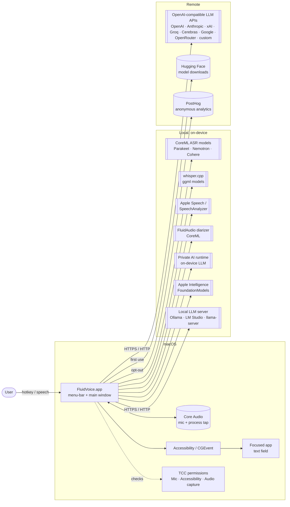
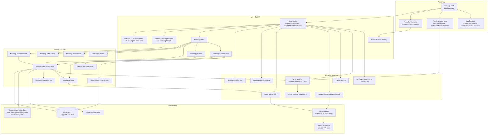
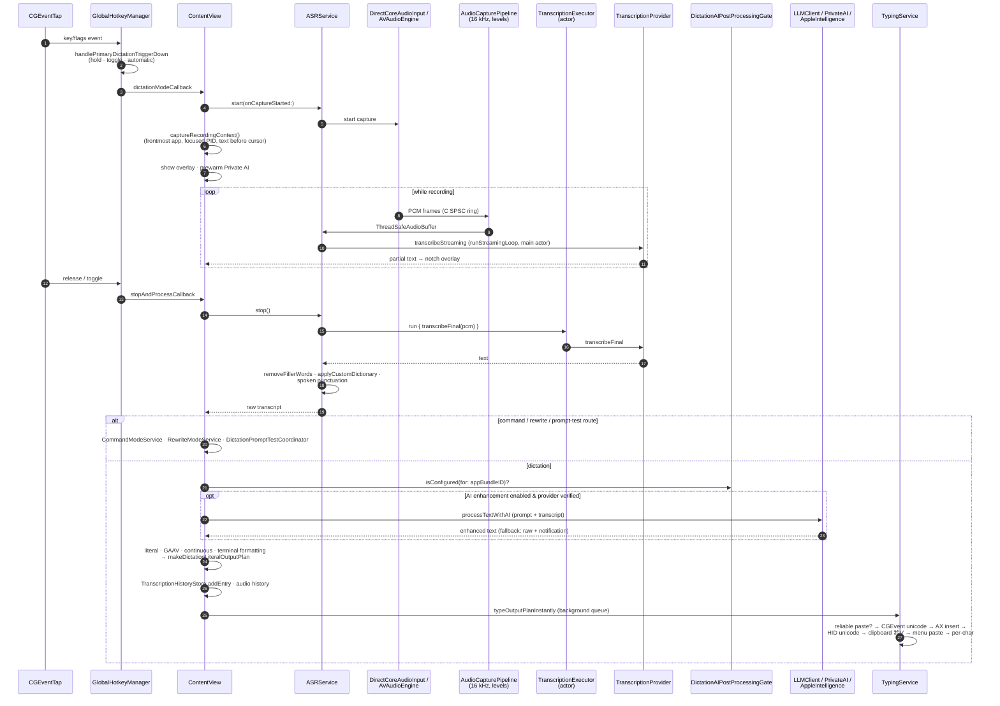
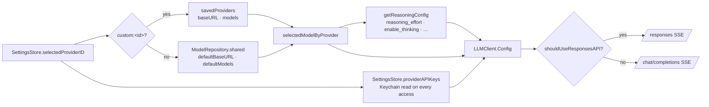
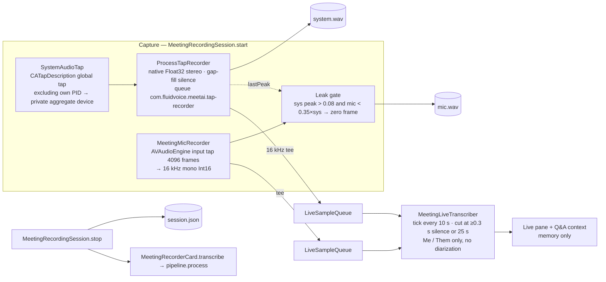

# FluidVoice Architecture

This document describes how FluidVoice works end to end: dictation, AI post-processing, text insertion, and the MeetAI meeting subsystem (recording, transcription, diarization, summaries). It has two halves:

- **Part 1 — Current state**: the app as it was at the start of the `meetai-v2-hardening` review (baseline commit `d2071ae` on top of `meetai-v2`).
- **Part 2 — Target state**: the app after the review fixes and refactor, with a delta table mapping each finding to the change that addressed it.

All paths are relative to `Sources/Fluid/` unless noted.

---

# Part 1 — Current state

## 1.1 System context



## 1.2 Process & component map



Notable: the **dictation pipeline is owned by a SwiftUI view**. `ContentView.handleContentAppear()` boots the runtime (menu bar, delayed `asr.initialize()`, accessibility polling, hotkey manager), and `GlobalHotkeyManager` lives in ContentView `@State`. Callbacks injected from ContentView drive start/stop/AI/typing.

## 1.3 Dictation: hotkey → text inserted



### ASR providers

| Provider | File | Backend | Streaming |
|---|---|---|---|
| `FluidAudioProvider` | `Services/FluidAudioProvider.swift` | FluidAudio Parakeet TDT v2/v3 (`AsrManager` ×2) — also handles `.qwen3Asr` | yes |
| `ParakeetRealtimeProvider` | `Services/ParakeetRealtimeProvider.swift` | FluidAudio `StreamingEouAsrManager` | yes |
| `NemotronProvider` | `Services/NemotronProvider.swift` | `NemotronStreamingAsrManager` (HF download) | yes; prefers native file transcription |
| `ExternalCoreMLTranscriptionProvider` | `Services/ExternalCoreMLTranscriptionProvider.swift` | Cohere 6-bit CoreML (`CohereTranscribeAsrManager`) | preview; prefers native file transcription |
| `WhisperProvider` | `Services/WhisperProvider.swift` | SwiftWhisper (whisper.cpp), ggml in `~/Library/Caches/WhisperModels` | small models only |
| `AppleSpeechProvider` | `Services/AppleSpeechProvider.swift` | `SFSpeechRecognizer` | yes |
| `AppleSpeechAnalyzerProvider` | `Services/AppleSpeechAnalyzerProvider.swift` | macOS 26 `SpeechAnalyzer` | yes |

FluidAudio-based providers are `#if arch(arm64)` only. Selection: `ASRService.transcriptionProvider` switches on `SettingsStore.SpeechModel`. Model preparation: `ensureAsrReady()` → `prepareProviderWithRecovery` → `provider.prepare`.

## 1.4 AI provider resolution



- Apple Intelligence (`Networking/AppleIntelligenceProvider.swift`) and Private AI (`Services/PrivateAIIntegrationService.swift`, actor) bypass `LLMClient`.
- Gate: `DictationAIPostProcessingGate` requires a non-Off prompt, per-app routing scope, and a *verified* provider (SHA256 of `baseURL|apiKey` in `verifiedProviderFingerprints`).
- Duplicated logic (current): `isLocalEndpoint` in 5 copies + 2 wrappers; reasoning-param `extraParameters` block copied in 7 call sites; provider/key resolution in 5 places.

## 1.5 Meeting recording



### On-disk layout

```
~/Library/Application Support/FluidVoice/
├── MeetingRecordings/
│   └── <ISO8601 meetingFileSafe timestamp>/      one folder per meeting / upload
│       ├── system.wav      far end (tap) or uploaded audio (16 kHz Int16)
│       ├── mic.wav         local mic ("Me"); 0.1 s silence for uploads
│       ├── session.json    MeetingRecordingArtifacts (folder, wavs, startedAt, endedAt)
│       ├── transcript.md   **[MM:SS] Speaker:** text
│       ├── summary.md      LLM summary (selected style)
│       ├── title.txt       "Short title (Wed 9 Jul, 3:04 pm)"
│       └── speakers.json   label → L2-normalised voice centroid
├── SpeakerProfiles/profiles.json   enrolled voices (running weighted centroids)
└── DictationAudioHistory/          optional dictation audio
UserDefaults: SettingsStore keys · TranscriptionHistoryEntries ·
              FileTranscriptionHistoryEntries (cap 50, incl. meetings) · CommandModeChatSessions
Keychain:     com.fluidvoice.provider-api-keys / fluidApiKeys (JSON dict)
Logs:         ~/Library/Logs/Fluid/Fluid.log
```

## 1.6 Meeting post-processing pipeline (current)

`MeetingTranscriptPipeline.process(_:)` — a `@MainActor ObservableObject`; **every stage below runs on the main thread except the awaited ASR/LLM calls.**

```mermaid
flowchart TB
    start([process artifacts]) --> lock[1 · MeetingFolderActivity.begin folder<br/>throws if busy]
    lock --> ready[2 · asrService.ensureAsrReady · fileTranscriptionProvider]
    ready --> micload[3 · loadSamples16kMono mic.wav<br/>⚠ sync on main]
    micload --> mictx[4a · transcribeTrack Me<br/>splitOnSilence ⚠ main · 30 s cap +1 s tail<br/>provider.transcribe per utterance<br/>⚠ every error swallowed]
    mictx --> sysload[3b · loadSamples16kMono system.wav ⚠ main<br/>mic samples still alive]
    sysload --> systx[4b · transcribeTrack Them]
    systx --> diar[5 · resolveSpeakers<br/>DiarizerManager threshold 0.75<br/>performCompleteDiarization ⚠ sync CoreML on main<br/>drop clusters &lt; 2 s · centroid · profile match ≥ 0.7<br/>dominant-overlap label]
    diar --> merge[6 · merge tracks by start]
    merge --> echo[7 · suppressEcho<br/>Me line dropped if Them line ±5 s, token sim ≥ 0.6]
    echo --> name[8 · MeetingSpeakerNamer LLM<br/>Them N → real names JSON]
    name --> enrol[9 · enrollProfiles · speakers.json]
    enrol --> md[10 · renderMarkdown → transcript.md]
    md --> histentry[11 · FileTranscriptionHistoryStore<br/>replace 'Meeting &lt;folder&gt;' entry]
    histentry --> sum[12 · summarize → MeetingAIClient<br/>failure only sets summaryError]
    sum --> title[13 · generateTitleLine → title.txt]
    title --> del[14 · deleteAudioIfConfigured<br/>⚠ default ON, no toggle,<br/>runs even if transcript empty / summary failed]
    del --> done([Complete])
```



### MeetingAIClient

- `resolveProvider()` reuses AI Enhancement settings; `contextBudgetTokens` = 4096 for Apple Intelligence, effectively unbounded otherwise.
- On "context / too long / maximum length / token limit" errors, halves the budget based on what was actually sent; 20 attempts for local endpoints, 4 for remote.
- `complete()` → Apple Intelligence, or `LLMClient` with temperature 0.3, reasoning extras, **180 s timeout**. Local servers: `waitForLocalEndpoint` (~40 s).
- To fit 180 s, the **shared** `LLMClient` URLSession's `timeoutIntervalForResource` was raised to 600 s for *every* caller.

## 1.7 Post-hoc operations (current)

| Operation | Entry | Path | Lock |
|---|---|---|---|
| Re-transcribe | `MeetingsView.reprocess` | `MeetingReprocessor.artifacts(inFolder:)` (needs both WAVs) → `MeetingTranscriptPipeline.sharedReprocessor.process` | folder |
| Reprocess on launch | `ContentView` → `MeetingReprocessor.runLaunchReprocessIfRequested` | one-shot defaults flags `MeetAIReprocessAllOnLaunch` / `…LatestOnLaunch` | folder |
| Regenerate summary | Summarise menu | `regenerateSummary(folder:style:)` → `plainTranscript` → `generateSummaryBody` | folder; UI progress via single `@State summarizingFolder` ⚠ |
| Relabel speaker | Name speakers section | `SpeakerProfileStore` enrol/move → `MeetingRelabeler.relabel` (transcript.md · history · speakers.json · summary · title) | folder |
| Q&A | `MeetingQAPanel` | live transcript, else **newest** "Meeting " history entry ⚠ → `MeetingQAService.ask` → `completeAboutTranscript` | none |
| Upload | File Transcription tab | `MeetingTranscriptionService.transcribeFile` → `Task.detached { MeetingUploadImporter.importArtifacts }` (full file in memory) → `process()` decodes it **again on main** ⚠ → result looked up by `"Meeting <timestamp>"` (upload filename lost) ⚠ | folder |

Pipeline instances that can exist at once: MeetingRecorderCard's own `@StateObject` (progress lost on navigation), the shared reprocessor, one per upload, one per launch-reprocess folder. Only `MeetingFolderActivity` (a `Set<String>` of busy folders) serialises them per folder.

## 1.8 Concurrency map (current)

The app target sets `SWIFT_DEFAULT_ACTOR_ISOLATION = MainActor` and `SWIFT_APPROACHABLE_CONCURRENCY = YES`. Consequences:

- Every type without an explicit annotation is main-actor isolated.
- A synchronous `nonisolated` function called from main **still runs on main**; a `nonisolated async` function runs on the caller's actor. Only `@concurrent` functions (or `Task.detached`) leave the main actor.

| Off main | On main (hot spots) |
|---|---|
| Audio IO threads (tap IOProc, AVAudioEngine tap, C ring) | `MeetingTranscriptPipeline`: decode, VAD, diarization, echo, markdown |
| `TranscriptionExecutor` actor (dictation ASR) | `MeetingLiveTranscriber.tick`: VAD every 10 s |
| `PrivateAIIntegrationService` actor | `ASRService.runStreamingLoop` |
| `TypingService` global queue | `usleep` in AVAudioEngine format retry; `TypingService.restoreCapturedFocus` sleeps |
| Upload import (`Task.detached`) | `SettingsStore.providerAPIKeys` Keychain read per access (29 call sites) |
| | History stores JSON-encode whole arrays into UserDefaults per save |

Also: `TypingService.virtualKeyCode` uses `DispatchQueue.main.sync` from a worker (deadlock-prone); `TypingService.isCurrentlyTyping` mutated off-main without synchronisation.

## 1.9 Build & dependencies (current)

- Real build: `Fluid.xcodeproj` (scheme `Fluid`), driven by `./build.sh` (ad-hoc signed; `install` copies to `/Applications`). `Package.swift` exists but cannot build the app (wrong target path, missing MediaRemoteAdapter, SwiftWhisper pin drift).

| Package | Pin (xcodeproj) | Used? |
|---|---|---|
| FluidAudio (altic-dev fork) | branch `B/cohere-coreml-asr` | yes — ASR, diarization (pulls swift-transformers, swift-jinja, swift-collections) |
| SwiftWhisper | 1.2.0 | yes |
| DynamicNotchKit (altic-dev fork) | branch `main` | yes — notch overlay |
| mediaremote-adapter | branch | yes — media pause/resume (arm64) |
| AppUpdater | 1.1.1 | **never imported** — only supplies PromiseKit transitively |
| PromiseKit | transitive 6.22.1 | yes — AppDelegate, MenuBarManager, SimpleUpdater, SettingsView |
| posthog-ios | Package.swift only | **never imported** (analytics posts raw HTTP) |

- Tests: single Xcode-only target `FluidDictationIntegrationTests` (dictation E2E, hotkeys, LLM request bodies, temperature support). **No meeting tests.**

## 1.10 Tech debt snapshot

- Largest files (lines): SettingsStore 4917 · ContentView 4458 · ASRService 3951 · BottomOverlayView 3286 · AISettingsView+AIConfiguration 2758 · WelcomeView 2669 · SettingsView 2611.
- Dead code: `Networking/AIProvider.swift`, `Networking/FunctionCallingProvider.swift`.
- `DictationPostProcessingService` near-duplicates `ContentView.processTextWithAI` (used only by the Local API).
- `.qwen3Asr` routes to the Parakeet provider with no Qwen-specific code.
- Meeting history in a 50-entry UserDefaults list: older meetings vanish from the Meetings list while their folders remain.

## 1.11 Code-review findings (baseline)

| # | Finding | Location |
|---|---|---|
| 1 | Audio deleted even when transcript empty or summary failed (default ON, no toggle) | `MeetingTranscriptPipeline.process` |
| 2 | Per-utterance catch swallows every error incl. cancellation and provider-wide failures | `transcribeTrack` |
| 3 | Decode / VAD / diarization on main; upload decodes the full file twice | pipeline, `MeetingTranscriptionService` |
| 4 | `MarkdownText` reads `components.first` → list items render as paragraphs | `UI/MarkdownText.swift` |
| 5 | Final utterance chunk can be 31 s, over the 30 s cap | `splitOnSilence` |
| 6 | Upload ignores `prefersNativeFileTranscription` | `MeetingTranscriptionService` |
| 7 | Upload result loses the original filename; empty-text guard dead; progress resets to 0 after "Complete!" | `MeetingTranscriptionService` |
| 8 | Single `summarizingFolder` state races across meetings | `MeetingsView` |
| 9 | `isLocalEndpoint` ×7 and reasoning-params ×7 duplicated | many |
| 10 | Session-wide 600 s resource timeout for all LLM calls | `LLMClient` |

---

# Part 2 — Target state

_Filled in once the hardening commits land._
