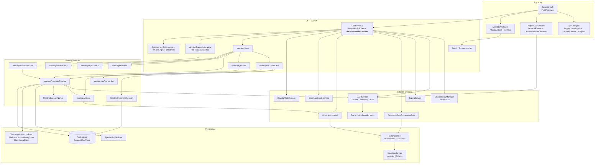
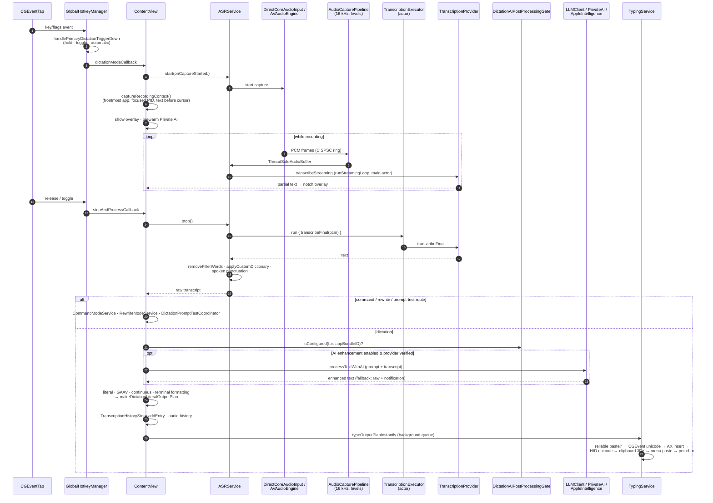
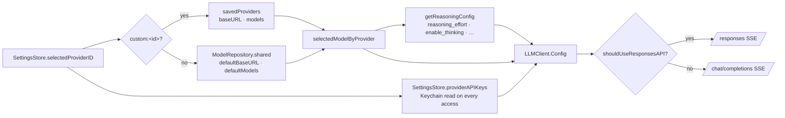
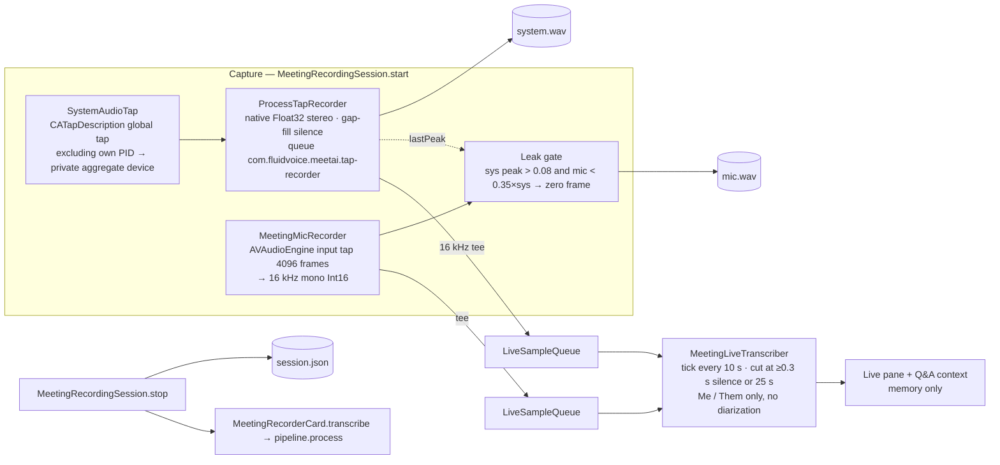
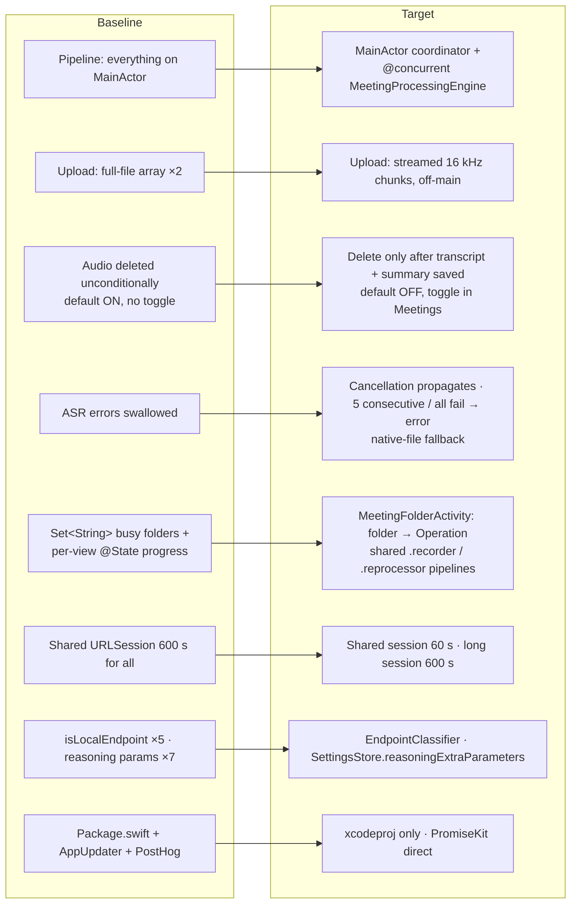
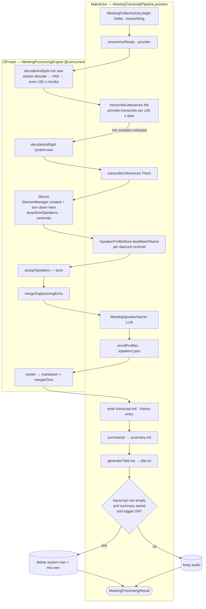
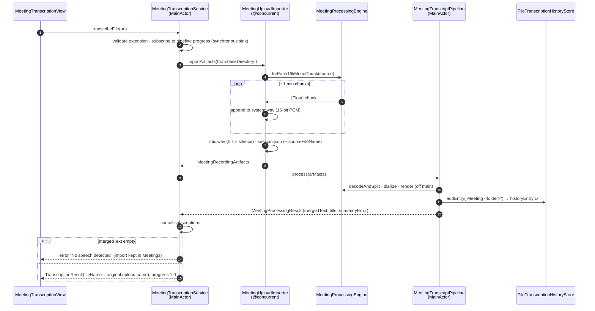
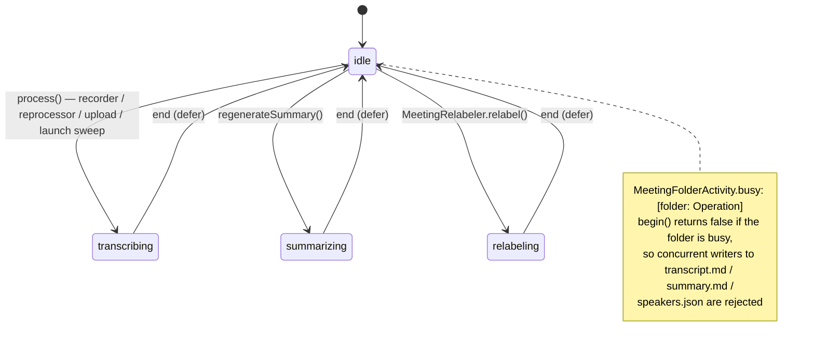
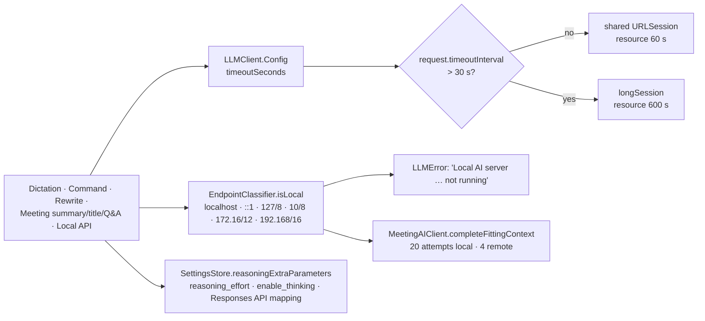

# FluidVoice Architecture

This document describes how FluidVoice works end to end: dictation, AI post-processing, text insertion, and the MeetAI meeting subsystem (recording, transcription, diarization, summaries). It has two halves:

- **Part 1 — Current state (baseline)**: the app as it was at the start of the `meetai-v2-hardening` review (baseline commit `d2071ae` on top of `meetai-v2`).
- **Part 2 — Target state**: the app after the review fixes and refactor on `meetai-v2-hardening` (implemented), with a delta table mapping each finding to its commit, and a roadmap of what is still open.

All paths are relative to `Sources/Fluid/` unless noted.

---

# Part 1 — Current state

## 1.1 System context


## 1.2 Process & component map



Notable: the **dictation pipeline is owned by a SwiftUI view**. `ContentView.handleContentAppear()` boots the runtime (menu bar, delayed `asr.initialize()`, accessibility polling, hotkey manager), and `GlobalHotkeyManager` lives in ContentView `@State`. Callbacks injected from ContentView drive start/stop/AI/typing.

## 1.3 Dictation: hotkey → text inserted



### ASR providers

| Provider | File | Backend | Streaming |
|---|---|---|---|
| `FluidAudioProvider` | `Services/FluidAudioProvider.swift` | FluidAudio Parakeet TDT v2/v3 (`AsrManager` ×2) — also handles `.qwen3Asr` | yes |
| `ParakeetRealtimeProvider` | `Services/ParakeetRealtimeProvider.swift` | FluidAudio `StreamingEouAsrManager` | yes |
| `NemotronProvider` | `Services/NemotronProvider.swift` | `NemotronStreamingAsrManager` (HF download) | yes; prefers native file transcription |
| `ExternalCoreMLTranscriptionProvider` | `Services/ExternalCoreMLTranscriptionProvider.swift` | Cohere 6-bit CoreML (`CohereTranscribeAsrManager`) | preview; prefers native file transcription |
| `WhisperProvider` | `Services/WhisperProvider.swift` | SwiftWhisper (whisper.cpp), ggml in `~/Library/Caches/WhisperModels` | small models only |
| `AppleSpeechProvider` | `Services/AppleSpeechProvider.swift` | `SFSpeechRecognizer` | yes |
| `AppleSpeechAnalyzerProvider` | `Services/AppleSpeechAnalyzerProvider.swift` | macOS 26 `SpeechAnalyzer` | yes |

FluidAudio-based providers are `#if arch(arm64)` only. Selection: `ASRService.transcriptionProvider` switches on `SettingsStore.SpeechModel`. Model preparation: `ensureAsrReady()` → `prepareProviderWithRecovery` → `provider.prepare`.

## 1.4 AI provider resolution



- Apple Intelligence (`Networking/AppleIntelligenceProvider.swift`) and Private AI (`Services/PrivateAIIntegrationService.swift`, actor) bypass `LLMClient`.
- Gate: `DictationAIPostProcessingGate` requires a non-Off prompt, per-app routing scope, and a *verified* provider (SHA256 of `baseURL|apiKey` in `verifiedProviderFingerprints`).
- Duplicated logic (current): `isLocalEndpoint` in 5 copies + 2 wrappers; reasoning-param `extraParameters` block copied in 7 call sites; provider/key resolution in 5 places.

## 1.5 Meeting recording



### On-disk layout

```
~/Library/Application Support/FluidVoice/
├── MeetingRecordings/
│   └── <ISO8601 meetingFileSafe timestamp>/      one folder per meeting / upload
│       ├── system.wav      far end (tap) or uploaded audio (16 kHz Int16)
│       ├── mic.wav         local mic ("Me"); 0.1 s silence for uploads
│       ├── session.json    MeetingRecordingArtifacts (folder, wavs, startedAt, endedAt)
│       ├── transcript.md   **[MM:SS] Speaker:** text
│       ├── summary.md      LLM summary (selected style)
│       ├── title.txt       "Short title (Wed 9 Jul, 3:04 pm)"
│       └── speakers.json   label → L2-normalised voice centroid
├── SpeakerProfiles/profiles.json   enrolled voices (running weighted centroids)
└── DictationAudioHistory/          optional dictation audio
UserDefaults: SettingsStore keys · TranscriptionHistoryEntries ·
              FileTranscriptionHistoryEntries (cap 50, incl. meetings) · CommandModeChatSessions
Keychain:     com.fluidvoice.provider-api-keys / fluidApiKeys (JSON dict)
Logs:         ~/Library/Logs/Fluid/Fluid.log
```

## 1.6 Meeting post-processing pipeline (current)

`MeetingTranscriptPipeline.process(_:)` — a `@MainActor ObservableObject`; **every stage below runs on the main thread except the awaited ASR/LLM calls.**


### MeetingAIClient

- `resolveProvider()` reuses AI Enhancement settings; `contextBudgetTokens` = 4096 for Apple Intelligence, effectively unbounded otherwise.
- On "context / too long / maximum length / token limit" errors, halves the budget based on what was actually sent; 20 attempts for local endpoints, 4 for remote.
- `complete()` → Apple Intelligence, or `LLMClient` with temperature 0.3, reasoning extras, **180 s timeout**. Local servers: `waitForLocalEndpoint` (~40 s).
- To fit 180 s, the **shared** `LLMClient` URLSession's `timeoutIntervalForResource` was raised to 600 s for *every* caller.

## 1.7 Post-hoc operations (current)

| Operation | Entry | Path | Lock |
|---|---|---|---|
| Re-transcribe | `MeetingsView.reprocess` | `MeetingReprocessor.artifacts(inFolder:)` (needs both WAVs) → `MeetingTranscriptPipeline.sharedReprocessor.process` | folder |
| Reprocess on launch | `ContentView` → `MeetingReprocessor.runLaunchReprocessIfRequested` | one-shot defaults flags `MeetAIReprocessAllOnLaunch` / `…LatestOnLaunch` | folder |
| Regenerate summary | Summarise menu | `regenerateSummary(folder:style:)` → `plainTranscript` → `generateSummaryBody` | folder; UI progress via single `@State summarizingFolder` ⚠ |
| Relabel speaker | Name speakers section | `SpeakerProfileStore` enrol/move → `MeetingRelabeler.relabel` (transcript.md · history · speakers.json · summary · title) | folder |
| Q&A | `MeetingQAPanel` | live transcript, else **newest** "Meeting " history entry ⚠ → `MeetingQAService.ask` → `completeAboutTranscript` | none |
| Upload | File Transcription tab | `MeetingTranscriptionService.transcribeFile` → `Task.detached { MeetingUploadImporter.importArtifacts }` (full file in memory) → `process()` decodes it **again on main** ⚠ → result looked up by `"Meeting <timestamp>"` (upload filename lost) ⚠ | folder |

Pipeline instances that can exist at once: MeetingRecorderCard's own `@StateObject` (progress lost on navigation), the shared reprocessor, one per upload, one per launch-reprocess folder. Only `MeetingFolderActivity` (a `Set<String>` of busy folders) serialises them per folder.

## 1.8 Concurrency map (current)

The app target sets `SWIFT_DEFAULT_ACTOR_ISOLATION = MainActor` and `SWIFT_APPROACHABLE_CONCURRENCY = YES`. Consequences:

- Every type without an explicit annotation is main-actor isolated.
- A synchronous `nonisolated` function called from main **still runs on main**; a `nonisolated async` function runs on the caller's actor. Only `@concurrent` functions (or `Task.detached`) leave the main actor.

| Off main | On main (hot spots) |
|---|---|
| Audio IO threads (tap IOProc, AVAudioEngine tap, C ring) | `MeetingTranscriptPipeline`: decode, VAD, diarization, echo, markdown |
| `TranscriptionExecutor` actor (dictation ASR) | `MeetingLiveTranscriber.tick`: VAD every 10 s |
| `PrivateAIIntegrationService` actor | `ASRService.runStreamingLoop` |
| `TypingService` global queue | `usleep` in AVAudioEngine format retry; `TypingService.restoreCapturedFocus` sleeps |
| Upload import (`Task.detached`) | `SettingsStore.providerAPIKeys` Keychain read per access (29 call sites) |
| | History stores JSON-encode whole arrays into UserDefaults per save |

Also: `TypingService.virtualKeyCode` uses `DispatchQueue.main.sync` from a worker (deadlock-prone); `TypingService.isCurrentlyTyping` mutated off-main without synchronisation.

## 1.9 Build & dependencies (current)

- Real build: `Fluid.xcodeproj` (scheme `Fluid`), driven by `./build.sh` (ad-hoc signed; `install` copies to `/Applications`). `Package.swift` exists but cannot build the app (wrong target path, missing MediaRemoteAdapter, SwiftWhisper pin drift).

| Package | Pin (xcodeproj) | Used? |
|---|---|---|
| FluidAudio (altic-dev fork) | branch `B/cohere-coreml-asr` | yes — ASR, diarization (pulls swift-transformers, swift-jinja, swift-collections) |
| SwiftWhisper | 1.2.0 | yes |
| DynamicNotchKit (altic-dev fork) | branch `main` | yes — notch overlay |
| mediaremote-adapter | branch | yes — media pause/resume (arm64) |
| AppUpdater | 1.1.1 | **never imported** — only supplies PromiseKit transitively |
| PromiseKit | transitive 6.22.1 | yes — AppDelegate, MenuBarManager, SimpleUpdater, SettingsView |
| posthog-ios | Package.swift only | **never imported** (analytics posts raw HTTP) |

- Tests: single Xcode-only target `FluidDictationIntegrationTests` (dictation E2E, hotkeys, LLM request bodies, temperature support). **No meeting tests.**

## 1.10 Tech debt snapshot

- Largest files (lines): SettingsStore 4917 · ContentView 4458 · ASRService 3951 · BottomOverlayView 3286 · AISettingsView+AIConfiguration 2758 · WelcomeView 2669 · SettingsView 2611.
- Dead code: `Networking/AIProvider.swift`, `Networking/FunctionCallingProvider.swift`.
- `DictationPostProcessingService` near-duplicates `ContentView.processTextWithAI` (used only by the Local API).
- `.qwen3Asr` routes to the Parakeet provider with no Qwen-specific code.
- Meeting history in a 50-entry UserDefaults list: older meetings vanish from the Meetings list while their folders remain.

## 1.11 Code-review findings (baseline)

| # | Finding | Location |
|---|---|---|
| 1 | Audio deleted even when transcript empty or summary failed (default ON, no toggle) | `MeetingTranscriptPipeline.process` |
| 2 | Per-utterance catch swallows every error incl. cancellation and provider-wide failures | `transcribeTrack` |
| 3 | Decode / VAD / diarization on main; upload decodes the full file twice | pipeline, `MeetingTranscriptionService` |
| 4 | `MarkdownText` reads `components.first` → list items render as paragraphs | `UI/MarkdownText.swift` |
| 5 | Final utterance chunk can be 31 s, over the 30 s cap | `splitOnSilence` |
| 6 | Upload ignores `prefersNativeFileTranscription` | `MeetingTranscriptionService` |
| 7 | Upload result loses the original filename; empty-text guard dead; progress resets to 0 after "Complete!" | `MeetingTranscriptionService` |
| 8 | Single `summarizingFolder` state races across meetings | `MeetingsView` |
| 9 | `isLocalEndpoint` ×7 and reasoning-params ×7 duplicated | many |
| 10 | Session-wide 600 s resource timeout for all LLM calls | `LLMClient` |

---

# Part 2 — Target state

Everything in this part is implemented on `meetai-v2-hardening` unless listed under §2.8 Roadmap. Dictation (§1.3), provider resolution (§1.4), recording (§1.5) and the on-disk layout (§1.5) are unchanged except where noted.

## 2.1 What changed at a glance



## 2.2 Meeting pipeline: coordinator + engine

`MeetingTranscriptPipeline` stays a `@MainActor ObservableObject`. It publishes progress and runs the steps that need main-actor state: the ASR provider, `SpeakerProfileStore`, `FileTranscriptionHistoryStore` and AI calls. CPU-heavy work moves to `MeetingProcessingEngine` (`Services/MeetingRecording/MeetingProcessingEngine.swift`), a `nonisolated enum`. Its expensive entry points are `@concurrent`, so they leave the main actor even under the app's default MainActor isolation.



Error handling in `transcribeUtterances`:

- `Task.checkCancellation()` runs before every utterance, and `CancellationError` is always rethrown.
- A single failed utterance is logged and skipped.
- Five failures in a row, or every utterance failing, throws `MeetingRecordingError` instead of producing an empty "successful" transcript.
- If utterance ASR fails and the provider has `prefersNativeFileTranscription` (Cohere/Nemotron), `transcribeTrack` falls back to `provider.transcribeFile(at:)` as a single segment. That track is then not diarized.

Decode fix: `forEach16kMonoChunk` now drains the `AVAudioConverter` with `.endOfStream` at EOF. Before, the resampler's filter latency (~85 ms on a 44.1 kHz file) was dropped from the end of every decoded file.

## 2.3 Upload flow (target)



## 2.4 Per-folder operations and UI state



| UI | State source |
|---|---|
| Meetings row progress bar | `MeetingTranscriptPipeline.shared(.reprocessor).processingFolderName/progress` |
| Meetings row spinner label | `MeetingFolderActivity.operation(for:)` → `progressLabel` (summarising with style, applying names, transcribing by another pipeline) |
| Re-transcribe / Summarise / Save & apply disabled | `MeetingFolderActivity.isBusy(folder)` |
| Recorder card | `MeetingTranscriptPipeline.shared(.recorder)` (survives navigation) |
| Q&A context | live transcript → **expanded meeting** → newest meeting |
| Delete-audio toggle | `@AppStorage("DeleteMeetingAudioAfterTranscription")` = `SettingsStore.deleteMeetingAudioAfterTranscription`, default **OFF** |
| Meetings list retention | 50-entry cap now evicts only non-meeting file transcriptions |

## 2.5 LLM plumbing



- `MeetingAIClient.completeFittingContext` is the trim-and-retry loop with an injectable completion. `isContextOverflow` is a pure predicate. Both are unit-tested.
- Removed dead code: `Networking/AIProvider.swift` (`AIProvider` and `OpenAICompatibleProvider`) and `Networking/FunctionCallingProvider.swift`.

## 2.6 Build, dependencies, tests

| Package | Before | After |
|---|---|---|
| FluidAudio (altic-dev fork) | `B/cohere-coreml-asr` @ 72625bb | @ **3fd6388** (pipelined Parakeet long-form, pronunciation customization; no diarizer changes) |
| mediaremote-adapter | `master` @ 78aae86 | @ **5b6afde** (race/deadlock fixes) |
| PromiseKit | transitive via AppUpdater | **direct**, 6.22.1 (latest 6.x) |
| AppUpdater (+ Path.swift, Version, PMKFoundation) | 1.1.1 | **removed** (never imported) |
| posthog-ios | `Package.swift` only | **removed** (never imported) |
| SwiftWhisper / DynamicNotchKit | 1.2.0 / `main` @ 708f31d | unchanged (already latest in range) |
| `Package.swift` + root `Package.resolved` | stale, could not build the app | **deleted**; `Fluid.xcodeproj` is the single source of truth |

Tests: all in the Xcode target `FluidDictationIntegrationTests`. Each new test file needs explicit pbxproj entries. App sources use a synchronized folder, so they don't.

| Suite | Covers |
|---|---|
| `MeetingPipelineTests` | `splitOnSilence` (cuts, blips, even ≤30 s chunks), echo suppression, merge, `dropShortSpeakers`, `assignSpeakers`, markdown render and `plainTranscript`, relabel rewrite, upload import (resample, manifest, empty-file cleanup) |
| `MarkdownTextTests` | bullets, ordinals, nesting depth, headers, inline bold |
| `LLMHelpersTests` | `EndpointClassifier`, `reasoningExtraParameters`, context-window retry convergence and caps |
| `FluidAudioSmokeTests` | Parakeet v2 on the fixture; diarizer through `MeetingProcessingEngine.diarize` (skip when models aren't cached) |
| existing | `DictationE2ETests` (Whisper tiny E2E + formatting), hotkeys, LLM request bodies, temperature support |

```bash
xcodebuild test -project Fluid.xcodeproj -scheme Fluid -destination 'platform=macOS' -only-testing:FluidDictationIntegrationTests CODE_SIGN_IDENTITY=- CODE_SIGN_STYLE=Manual DEVELOPMENT_TEAM=
```

## 2.7 Concurrency rules (read before adding meeting code)

1. The app target compiles with `SWIFT_DEFAULT_ACTOR_ISOLATION = MainActor` and Swift 5 language mode, so isolation violations are **warnings**, not errors. Don't add new ones.
2. `nonisolated` on a synchronous function does **not** move work off main when it's called from main. Mark CPU-heavy async entry points `@concurrent`, and make the types they take or return `nonisolated` and `Sendable` (`MeetingSegment`, `MeetingRecordingArtifacts`, `MeetingRecordingError`).
3. Don't call `DebugLogger`, `SettingsStore` or any store from engine code. Return values and let the coordinator log or persist.
4. Create non-Sendable framework objects (e.g. `DiarizerManager`) inside the `@concurrent` function that uses them.
5. Any writer to a meeting folder must claim it with `MeetingFolderActivity.begin(folder, operation)` and release it in `defer`.

## 2.8 Code-review findings → fixes

| # | Finding | Fix | Commit |
|---|---|---|---|
| 1 | Audio deleted after empty transcript / failed summary | Gated on non-empty transcript and a saved summary; default OFF; toggle | `187ec54` |
| 2 | Per-utterance catch swallowed cancellation and systemic failures | Cancellation propagates; 5 consecutive / all failures throw | `187ec54` |
| 3 | Decode/diarization on main; upload double full-file load | `MeetingProcessingEngine` `@concurrent` stages; streamed import; one track in memory | `187ec54` |
| 4 | `MarkdownText` list items rendered as paragraphs | Kind from first header/list-item component; depth indent | `06c8be9` |
| 5 | Final chunk up to 31 s | Even split, every chunk ≤30 s and ≥15 s | `a0e96d5` |
| 6 | Upload ignored native file transcription | Native-file fallback when utterance ASR fails | `187ec54` |
| 7 | Upload result lost filename, dead guard, progress reset | `MeetingProcessingResult`; `sourceFileName`; "No speech detected"; final progress kept | `187ec54` |
| 8 | `summarizingFolder` race | `MeetingFolderActivity` operation per folder | `187ec54` |
| 9 | Duplicated helpers | `EndpointClassifier`, `reasoningExtraParameters`; dead providers removed | `5c92f93` |
| 10 | Session-wide 600 s timeout | Dedicated long session | `5c92f93` |
| — | Resampler tail dropped (found by new tests) | Drain converter at EOF | `187ec54` |

## 2.9 Roadmap (not done in this pass)

Ordered by value ÷ risk:

1. **Move dictation orchestration out of `ContentView`.** Today the hotkey manager, stop → AI → typing chain and runtime boot live in a 4.4k-line SwiftUI view. Extract a `DictationCoordinator` owned by `AppServices`, and have `DictationPostProcessingService` replace `ContentView.processTextWithAI`, removing the duplicate.
2. **`TypingService` thread safety.** Remove `DispatchQueue.main.sync` from `virtualKeyCode`, and synchronise `isCurrentlyTyping`.
3. **Keychain read per API-key access.** Cache `providerAPIKeys` in memory and invalidate on write (29 call sites).
4. **Meeting index from disk.** List meetings from `MeetingRecordings/*/session.json` instead of the UserDefaults history blob, which also removes the need for the history-cap exception.
5. **Live transcriber VAD on main.** Route `MeetingLiveTranscriber.tick`'s `splitOnSilence`/`lastSilenceCut` through an `@concurrent` engine call.
6. **ASR provider isolation.** Meeting ASR calls the provider directly, so it can overlap live dictation. Route it through `ASRService.transcriptionExecutor`.
7. **Split the large files** (`SettingsStore` 4.9k, `ContentView` 4.4k, `ASRService` 3.9k lines) along the seams above.
8. **Swift 6 language mode** once the remaining ~75 isolation warnings are cleared.
9. **`.qwen3Asr`** routes to the Parakeet provider with no Qwen-specific code. Implement it or hide it.
